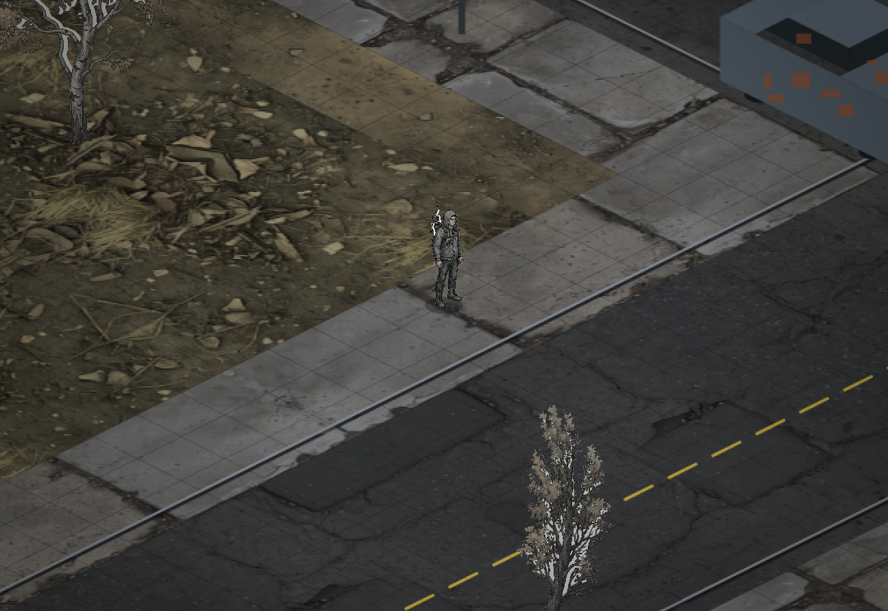

# МЁРТВЫЙ РАЙОН

**Браузерный изометрический survival про зомби-апокалипсис в пригороде.** Мёртвая трава, пепел на асфальте, тёплый свет в окнах пустых домов. Изометрия в духе Project Zomboid — но в браузере, на Canvas 2D, без движка.

▶ **Играть:** https://k8rvin.github.io/pepelopad/



---

## Что в игре

- **Пригород**: одноэтажные дома с двускатной крышей и сайдингом, открытые газоны, подъездные дорожки с машинами, без заборов; POI-кварталы (парк, супермаркет, школа, больница, полиция, АЗС)
- **Бой**: лук с отдельной позой полного натяжения и прицеливанием в обе стороны, экранный хит-тест по силуэту зомби; стрелы сталкиваются со стенами и проёмами — стрельба внутри зданий и через двери/разбитые окна работает; ближний бой (бита/нож) с анимацией замаха и удара оружием в руке; стаи плотные (~4450 зомби по городу, ночью гуще), тревога распространяется по соседям
- **Враги**: ходок, бегун, громила и Матка (босс с призывом подкреплений и полосой HP); ночные притоки вокруг игрока
- **Выживание**: день/ночь, стамина (Shift — спринт), голод, инфекция и лечение (H), регенерация, тушёнка и бинты; стелс с приседом (R), проверкой прямой видимости и радиусом шума; факел как источник света (зажигание из рюкзака, догорает); фары машины ночью включаются автоматически; обыск контейнеров со шкалой времени (пустые не предлагаются)
- **Прогрессия**: 7 навыков и 4 характеристики «учись делая» (панель P), XP за реальные действия; повышение уровня — золотой баннер с эффектом навыка, искры вокруг игрока и восходящий перезвон (WebAudio-синтез, без ассетов)
- **Машины**: процедурная iso-модель на любом курсе (без ступенек), топливо в литрах, таран, багажник (T); сносят столбы/заборы/контейнеры/бочки/скамейки на скорости
- **Лагеря выживших**: парк, школа, полиция и сюжетный мотель; доверие 4 уровня, бартер-торговля, пожертвования, поручения на доставку, постройки с ежедневным производством и лазаретом; костры светят ночью
- **База с выжившими (V)**: основание на газоне рядом с жилым домом, оборудованный интерьер (спальня/лазарет/склад/верстак/рация), заколоченные окна и дверь, постройки, жители, ночные рейды и склад
- **Кампания «Последний список»**: стартовое обучение и 16 сюжетных миссий в шести частях, 12 авторских побочных историй; поиск Марка, расследование отказов мотеля, две общины, осада и три финала с последствиями
- **Обучение на АЗС**: гарантированные ящики материалов, крафт стрел/ножа/аптечки, объяснения Олега и реальная практика на мишени; на объяснениях мир полностью приостанавливается
- **Диалоги с портретами**: крупная панель и текст, настоящие портреты Олега, Веры, Саныча, Раи, Лены и Дэна справа; для остальных персонажей — текущие спрайты как fallback
- **Спасение выживших**: сопровождение с командами «следовать/ждать», здоровье спутников, присоединение к жителям лагерей; гибель свидетеля не блокирует основную историю
- **Мотель как дом**: ремонт генератора и ворот, кухня, лазарет, собственный номер с ящиком, сном и точкой возрождения; отдельная миссия на ремонт и доставку груза фургоном
- **Интерьеры**: открытая гостиная/кухня у входа, короткий коридор, две спальни, ванная и прачечная в жилых домах; новая мебель GPT и процедурные модели, лут в подходящих контейнерах, вход через разбитые окна (B); зомби заходят внутрь и ищут обход через коридор
- **Сохранения**: версионированная схема v6 с миграциями v1–v5, автосейв 15 с; сохраняются квесты, улики, выжившие, сюжетные объекты, дом и контрольные точки осады
- **Yandex SDK**: подключение только на платформе (локальный no-op), `LoadingAPI.ready`, `GameplayAPI.start/stop`; облачная синхронизация сейвов в gzip с выбором более нового по времени; лидерборды `survival_days` и `zombie_kills`; реклама и in-app purchases отключены
- **Интерфейс**: игровой HUD с полосками HP/сытости и хотбаром, тосты, главное меню и настройки громкости, журнал (J), миникарта и большая карта с POI/лагерями/маркером (M), пиксель-иконки предметов, экран смерти со статистикой и ценой возрождения; постоянная панель цели квеста слева сверху и панель оружия с хоткеями; подсветка цели квеста (свечение силуэта, вариант переключается F6)
- **Звук**: единый процедурный WebAudio-движок — эффекты боя/крафта/UI, эмбиент дня и ночи, звук двигателя от скорости; перезвон повышения уровня встроен в общий движок (без внешних файлов)
- **Надёжность**: загрузочный экран, error boundary с отчётом об ошибке вместо зависшего чёрного экрана

## Управление

| Клавиша | Действие |
| --- | --- |
| WASD / Shift | движение / спринт (стамина); в машине — газ/тормоз/руль |
| ЛКМ | лук: удерживать — натяжение → выстрел; ближний бой — удар; Молотов — бросок |
| 1 / 2 / 3 / 4 | лук / бита / нож / коктейль Молотова (экипировка) |
| E | обыск / сесть / выйти / диалог / сюжетный объект |
| I / Tab · C · P | рюкзак · крафт · персонаж |
| J · M | журнал · карта |
| Q · H | съесть · бинт |
| T · F · V | багажник · заправить · база |
| Y | ремонт машины (детали) |
| G | спутник следует / ждёт; E больше не переключает спутника и не мешает луту |
| B · X | постройка / разбить окно · крафт |
| N · Z · F6 | факел · приближение камеры 1↔2 · вариант подсветки цели |
| R · Esc · F3 | присед · пауза · отладка; на экране смерти R — возрождение; в диалоге 1/2/3 — выбор ответа |

## Технологии

- **Canvas 2D**, без WebGL. Мир в метрах прямоугольный — изометрия только в проекции рендера
- **Vite** + Vitest + Playwright, CI/CD через GitHub Actions → GitHub Pages
- Ассеты: спрайты, окна, пропсы и мебель — GPT; обработка кадров и пропсов — headless-canvas скрипты в `scripts/`; машины — процедурные Canvas 2D-модели на любом курсе
- Данные (предметы, рецепты, навыки, зомби, квесты) отдельно от механик: `src/iso/data/`

## Запуск локально

```bash
npm install
npm run dev        # http://localhost:5173
npm test           # юнит-тесты
npm run test:e2e   # браузерные сценарии
npm run build      # production-сборка
```

Повторная обработка уже сохранённых GPT-исходников (не нужна для запуска игры):

```bash
python -m pip install -r scripts/requirements-gpt-assets.txt
python scripts/process_gpt_assets.py
```

Повторная обработка отобранных портретов из `tmp/` (JPEG → игровые PNG 384 px, с исходниками и метаданными):

```bash
node scripts/process_portraits.mjs
```

## Структура

```
├── index.html          # единственная точка входа (новый город)
├── src/iso/            # игра: core / data / world / render / systems / ui / persistence
├── tests/              # unit (iso*) + e2e (city*)
├── assets-src/         # оригиналы сгенерированных ассетов + метаданные
├── public/assets/      # runtime-ассеты (textures/, gen/)
├── scripts/            # обработка ассетов, замеры нагрузки, контрольные скриншоты
└── docs/               # консультации прошлых сессий, скриншоты
```

---

*Бывш. ПЕПЕЛОПАД. Город — вымышленный пригород, название — «МЁРТВЫЙ РАЙОН»; дух тот же.*